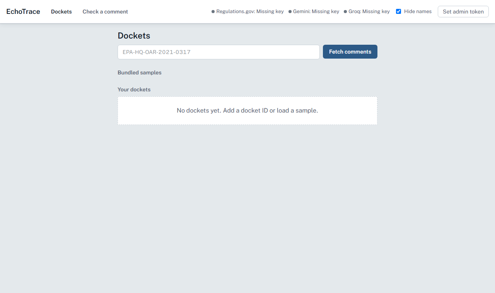

# EchoTrace

EchoTrace finds families of reworded public comments on U.S. government rulemaking dockets and has an AI agent explain, with cited evidence, whether a family looks like a coordinated campaign. It shows when many apparent voices are really one — without ever claiming to detect "fake" commenters, since text alone can't prove identity.



## Running locally (Windows 11, PowerShell, no Docker)

```powershell
# backend
cd backend
py -3.11 -m venv .venv
.venv\Scripts\Activate.ps1          # if blocked: Set-ExecutionPolicy -Scope CurrentUser RemoteSigned
pip install -r requirements.txt
copy .env.example .env               # then fill in keys, see below
python scripts\check_connectivity.py
uvicorn app.main:app --reload --port 8000

# frontend (second terminal)
cd frontend
npm install
npm run dev                           # http://localhost:5173
```

## Keys needed

Add these to `backend/.env` (never commit this file):

| Key | Where to get it | Free tier |
|---|---|---|
| `REGULATIONS_API_KEY` | [api.data.gov](https://api.data.gov/signup/) | ~1,000 requests/hour |
| `GEMINI_API_KEY` | [Google AI Studio](https://aistudio.google.com/) | Used for embeddings + fallback LLM |
| `GROQ_API_KEY` | [Groq Console](https://console.groq.com/) | Used as the primary LLM |

Without keys, the app still runs — `GET /api/v1/health` reports which providers are configured, and the UI shows "Missing key" per provider. Loading a bundled sample docket (once one is committed) works offline except for the AI calls.

## What's implemented

- **Backend** (Python/FastAPI/SQLModel): ingestion, embeddings, union-find clustering, campaign-shape metrics, AI-style scoring, a provider-agnostic agent loop with citation validation, and the full `/api/v1` REST surface — all tested against fakes, no real network calls in the test suite.
- **Frontend** (React/Vite/TypeScript/Tailwind): docket management, the full analysis pipeline view, the evidence board (built with `@xyflow/react`), verdict review, and the single-comment check flow.

See `docs/NOTES.md` for the full build log, including two items still blocked on real API keys (a committed real sample docket, and a real end-to-end pipeline run) and three deployment tasks blocked on external hosting accounts (Supabase, Render, Vercel/Netlify).

## Known limitations

- EchoTrace cannot tell a real organisation whose members each reworded a shared template apart from one actor using many fake names — text alone can't prove identities. The verdict is always "one campaign," never "fake people."
- The AI-style signal is an unverified LLM judgement and carries low weight in the scoring by design — it can raise a campaign score but can never, on its own, produce a `coordinated_paraphrase_campaign` verdict.
- Quality depends on the embeddings: very loose paraphrases may be missed, and comments under 25 words are excluded from clustering entirely.
- Regulations.gov only exposes text typed directly into the comment form; attachment-only comments are skipped and counted separately.

## Docs

- [`docs/PRD.md`](docs/PRD.md) — what and why
- [`docs/ARCHITECTURE.md`](docs/ARCHITECTURE.md) — stack, algorithms, schema, API, runtime agent
- [`docs/DESIGN_SYSTEM.md`](docs/DESIGN_SYSTEM.md) — UI direction, tokens, components, copy rules
- [`docs/TASKS.md`](docs/TASKS.md) — build checklist and progress
- [`docs/NOTES.md`](docs/NOTES.md) — decisions, calibrated thresholds, connectivity results, timings
- [`docs/DEMO.md`](docs/DEMO.md) — a walkthrough script for demoing the app
